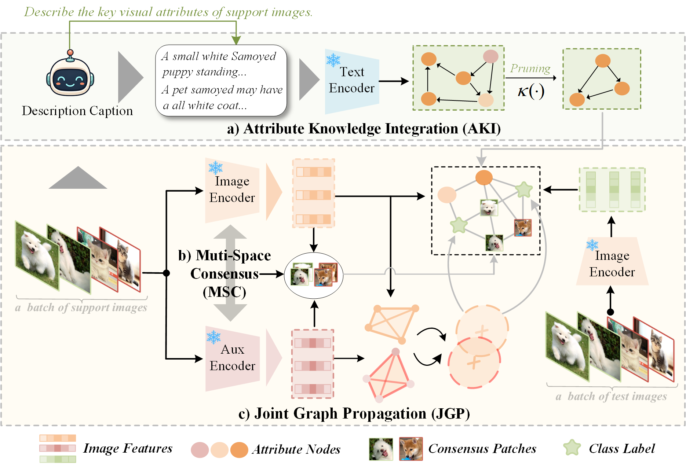
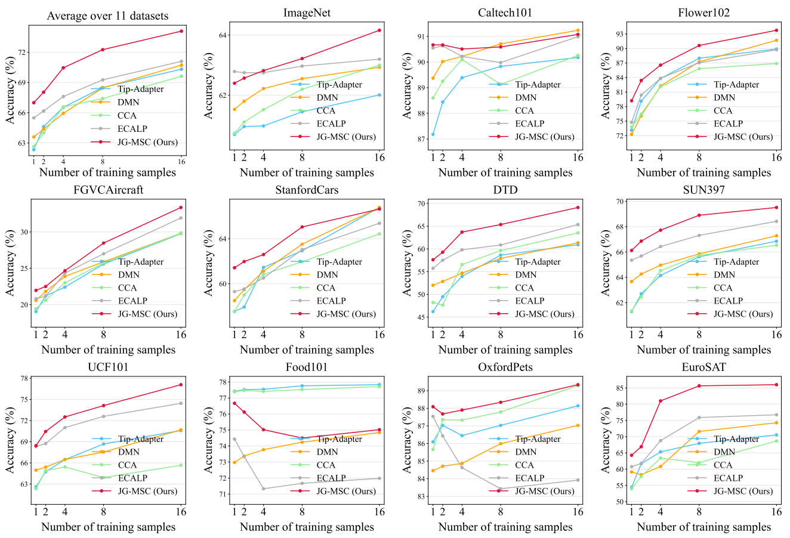

# JG-MSC: Joint Graphs with Multi-Space Consensus for Few-Shot Learning

**Joint Graphs with Multi-Space Consensus (JG-MSC)**, a training-free framework for CLIP-based few-shot image classification. JG-MSC improves graph-based label propagation by exploiting complementary semantic and visual evidence in CLIP and MoCo v3 representation spaces. It contains three components:

- **Attribute Knowledge Integration (AKI)** removes unreliable descriptions using visual evidence from the support set and introduces the retained attributes as semantic graph nodes.
- **Multi-Space Consensus (MSC)** identifies discriminative local regions that receive consistent support in both CLIP and auxiliary visual spaces.
- **Joint Graph Propagation (JGP)** calibrates graph relations using structural consensus across the two representation spaces before label propagation.

<p align="center">
  
</p>

## Main Results

JG-MSC is evaluated on eleven few-shot classification benchmarks under 1-, 2-, 4-, 8-, and 16-shot settings. The repository also supports cross-domain evaluation on ImageNet-A, ImageNet-V2, ImageNet-R, and ImageNet-Sketch.

<p align="center">
  
</p>

## Repository Structure

```text
JG-MSC-main/
├── JG_MSC.py                         # JG-MSC evaluation and ablation entry point
├── clip/
│   ├── extract_aligned_clip_moco_features.py
│   ├── moco.py                       # MoCo v3 model utilities
│   └── ...                           # CLIP implementation and tokenizer
├── datasets/                         # Dataset definitions
├── utils/                            # Graph label propagation utilities
├── framework.png
├── avg_result.png
├── requirements.txt
└── README.md
```

## Requirements

```bash
git clone https://github.com/fhqxa/JG-MSC.git
cd JG-MSC

conda create -n jgmsc python=3.9 -y
conda activate jgmsc

# Install a PyTorch build compatible with your CUDA version first.
pip install torch torchvision
pip install -r requirements.txt
pip install networkx pillow
```

## Datasets and Text Descriptions

### Few-Shot Benchmarks

The eleven supported benchmarks are:

- ImageNet
- Caltech101
- Oxford Flowers 102 (`Flowers102`)
- FGVC-Aircraft (`Aircraft`)
- Stanford Cars (`Cars`)
- Describable Textures Dataset (`DTD`)
- SUN397
- UCF101
- Food101
- Oxford-IIIT Pet (`Pets`)
- EuroSAT

Dataset preparation follows the splits commonly used by Tip-Adapter. Please refer to the [Tip-Adapter dataset instructions](https://github.com/gaopengcuhk/Tip-Adapter/blob/main/DATASET.md) for downloading and organizing the datasets.

### Out-of-Distribution Benchmarks

The following ImageNet variants are supported:

- ImageNet-A

- ImageNet-V2

- ImageNet-R

- ImageNet-Sketch

  

The expected feature layout is:

```text
features_mocov3_aligned_16shot/
└── fine_grained/
    ├── RN/
    │   ├── Aircraft.pt
    │   └── few_shots/
    │       └── Aircraft.pt
    ├── MOCO/
    │   └── R50/
    │       ├── Aircraft.pt
    │       └── few_shots/
    │           └── Aircraft.pt
    └── Aircraft_aligned_meta.pt
```


### All Eleven Benchmarks

After extracting the required features for every dataset, run:

```bash
python JG_MSC.py \
    --datasets ALL \
    --shots 1,2,4,8,16 \
    --modules full \
    --features_path ./features_mocov3_aligned_16shot \
    --moco_features_path ./features_mocov3_aligned_16shot/fine_grained/MOCO/R50 \
    --meta_root ./features_mocov3_aligned_16shot/fine_grained \
    --mocov3_ckpt /path/to/r-50-1000ep.pth.tar \
    --patch_variant on \
```

## Acknowledgements

This repo benefits from [ECALP](https://github.com/Yushu-Li/ECALP). Thanks for their excellent works.

## Contact

For questions or suggestions, please contact:

- Hong Zhao: `zh1127@mnnu.edu.cn`
- Hongyi Chen: `hongyichencn@163.com`
